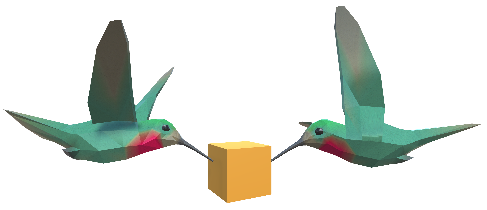

# Colibri

Colibri synchronizes objects and data between apps for fast cross-reality prototyping in research.

## Supported platforms

| Platform | Client |
| --- | --- |
| Unity | [colibri-unity](colibri-unity/README.md), Unity 2022.3 or newer |
| TypeScript | [colibri-web](colibri-web/README.md), [`@hcikn/colibri`](https://www.npmjs.com/package/@hcikn/colibri) on npm |

More to follow.

## Features

Colibri focuses on three key areas:

- **Low Barrier:** Setup and development are as simple as possible, with little to no configuration or code required.
- **Multi-Platform:** Colibri synchronizes data between different platforms.
- **Lab Conditions:** XR research prototypes usually run under ideal lab conditions. Colibri therefore puts low
  latency and high throughput first, at the cost of bandwidth and security.

> [!WARNING]
> Colibri has no authentication. Anyone who can reach a server can join any app on it and read and change its data.
> Do not send sensitive data through the public test server. For sensitive data, run your own server on a trusted network.

Included:

- Messages between clients
- Synchronized (3D) objects
- Data store on the server (for small configuration data)
- Monitoring in the browser:
  - The log of every client, so you can read the log of apps on smartphones and head-mounted displays without a
    cable or debugger
  - The connected clients with their latency and throughput
  - The synchronized objects
- Voice chat

## Getting started

Follow the README of your platform:

- [Unity](colibri-unity/README.md#installation)
- [TypeScript](colibri-web/README.md#installation)

You can start with the public test server
`colibri.hci.uni-konstanz.de`. To run your own server, see [colibri-server](colibri-server/README.md).

## Upgrading from Colibri 1

Colibri 2 does not work with Colibri 1. Clients and server must all run Colibri 2. To upgrade a project, follow the
[migration guide](MIGRATION.md).

## Citation

> Sebastian Hubenschmid\*, Daniel Immanuel Fink\*, Johannes Zagermann, Jonathan Wieland, Harald Reiterer, Tiare Feuchtner. In: *ISMAR'23 Adjunct.* 2023. **Colibri: A toolkit for rapid prototyping of networking across realities**. doi: [10.1109/ISMAR-Adjunct60411.2023.00010](https://doi.org/10.1109/ISMAR-Adjunct60411.2023.00010)

Published at the ISMAR'23 Adjunct "1st Joint Workshop on Cross Reality". Metadata: [CITATION.cff](CITATION.cff).
Contact: [Sebastian Hubenschmid](https://hci.uni-konstanz.de/personen/wissenschaftliche-mitarbeiterinnen/sebastian-hubenschmid/) ([GitHub](https://github.com/SebiH)), [Daniel Fink](https://hci.uni-konstanz.de/personen/wissenschaftliche-mitarbeiterinnen/daniel-fink/) ([GitHub](https://github.com/dunifi91)).

## Projects built with Colibri

| [ReLive](https://github.com/hcigroupkonstanz/ReLive) | [STREAM](https://github.com/hcigroupkonstanz/STREAM) |
| --- | --- |
|  |  |
| [**Re-Locations**](https://github.com/hcigroupkonstanz/Re-locations) | [**ARound the Smartphone**](https://github.com/hcigroupkonstanz/ARound-the-Smartphone) |
|  |  |

## License

[MIT](LICENSE)
