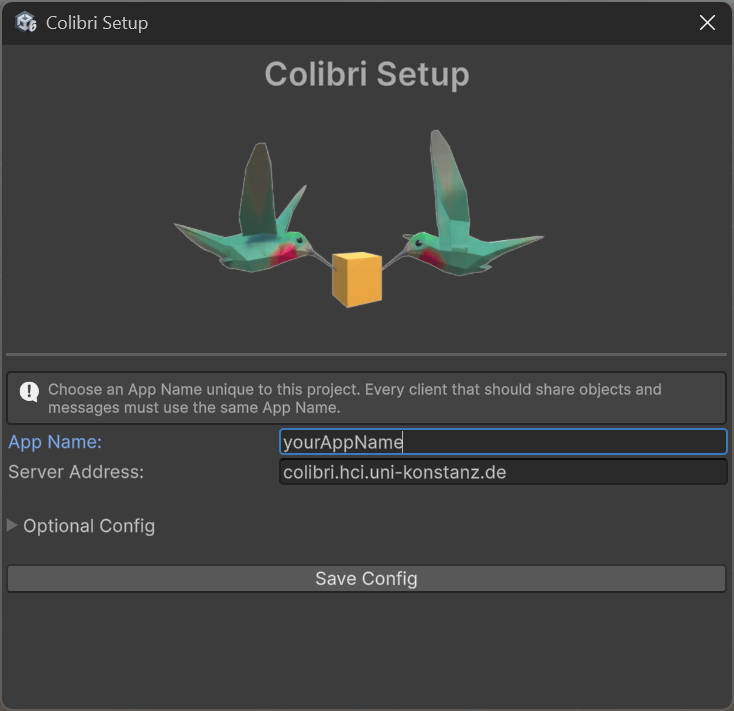

# Colibri Unity

Unity client for Colibri supporting messages between clients, synchronized objects, data store, monitoring, and voice chat.

[Full documentation](https://colibri.hci.uni-konstanz.de/unity/installation)

Upgrading from Colibri 1.x: [Migration Guide](../MIGRATION.md).

## Requirements

- Unity 2022.3 or newer
- [colibri-server](../colibri-server/README.md#installation) 2.0.0 or newer

## Installation

### Package Manager (recommended)

In *Window → (Package Management →) Package Manager → + → Install package from git URL*, enter:

```
https://github.com/hcigroupkonstanz/Colibri.git?path=colibri-unity/Assets/Colibri
```

### UnityPackage

1. Download the latest `.unitypackage` from the
   [releases page](https://github.com/hcigroupkonstanz/Colibri/releases) and import it with
   *Assets → Import Package → Custom Package*.
2. In *Window → (Package Management →) Package Manager → + → Install package by name*, enter:
   ```
   com.unity.nuget.newtonsoft-json
   ```

## Configuration

1. In *Window → Colibri Configuration*:
   - Set **App Name** to a unique name that is not used on the server. Clients exchange data only if their app names match. The examples and samples use `myAppName`.
   - Set **Server Address** to the address of the Colibri server you want to use. The address is a host name or IP address without `http://`. A public test server is available: `colibri.hci.uni-konstanz.de`.
   - Click *Save Config*.  
   
2. Enable *Project Settings → Player → Resolution and Presentation → **Run In Background/Run Without Focus***. Otherwise a
   Unity Editor not in focus sends nothing and calls no listeners.

## Samples

Samples can be found in the Samples tab in the Package Manager or in the `Samples/Colibri` folder when installed via `.unitypackage`.

To try out the samples you have the following options:

- Copy the `Assets`, `Packages` and `ProjectSettings` folders to a new folder and open it from Unity Hub as a second client. Unity cannot open one project twice.
- Build the project and run it on a second device.

## Usage

### Send/Receive Messages

For sending simple messages of events and commands you can use `Sync.Send`. Each message has a channel name.

```c#
float myNumber = 5f;
Sync.Send("myChannel", myNumber);
```

A client receives the messages of every channel it listens to:

```c#
void Start()
{
    Sync.Receive<float>("myChannel", OnMyChannel);
}

private void OnMyChannel(float myNumber)
{
    // This code is executed whenever
    // a float is received on "myChannel"
}
```

A full example:

```c#
using HCIKonstanz.Colibri.Synchronization;
using UnityEngine;

public class RoundControl : MonoBehaviour
{
    // Register before anything is sent. Messages without a listener are dropped.
    void Start()
    {
        Sync.Receive<int>("startRound", OnStartRound);
    }

    void OnStartRound(int round)
    {
        Debug.Log($"Round {round} starts");
        // reset the scores, start the timer, ...
    }

    // Reaches all other clients with the same app name, not this one.
    public void StartRound(int round)
    {
        Sync.Send("startRound", round);
        OnStartRound(round);
    }
}
```

In `Start`, the script listens on the channel `startRound` for `int` values. One player calls
`StartRound`, e.g. from a UI button, which sends the round number to all other clients. On each of them,
Colibri calls `OnStartRound`, which starts the round. A client does not receive its own messages, so
`StartRound` also calls `OnStartRound` directly to start the round on the sending client too.

- Channel and type must match on both sides.
- Supported types: `bool`, `int`, `float`, `string`, `Vector2`, `Vector3`, `Quaternion`, `Color` and arrays
  of these. Send other types as [`JToken`](https://colibri.hci.uni-konstanz.de/unity/messages#sending-other-types-as-json).
- Listeners that are methods of a `MonoBehaviour` script are removed when it is destroyed. Remove other listeners
  with `Sync.Unregister`.

### SyncTransform

`SyncTransform` keeps the position, rotation, scale and visibility of an object the same on all clients,
without any code, e.g. for a shared 3D object that one user moves and all others see.

- Add `SyncTransform` to a GameObject to sync its active state, position, rotation and scale.
- Late joiners receive the current state. The server discards the state when the app's last client disconnects.
- Move an object from one client at a time. Concurrent updates make it jitter.
- For dynamically created objects (instantiated at runtime), add the `[SyncTransformManager]` prefab from `Packages/Colibri/Prefabs/`
  to the scene and set its `Template` to the object's prefab. Give the prefab a `ModelId` and leave its `Id`
  empty.
- Physics:
    - For an object with a `Rigidbody`, only one client calculates the physics and the others follow its position. Enable `PhysicsAuthority` on the `SyncTransform` of the client that should calculate the physics.
    - Enabling it on one client disables it on all others. If it is enabled by default (in the scene or prefab), the first client gets the authority.
    - Set `isKinematic` on the `SyncTransform`, not on the `Rigidbody`. The `SyncTransform` overwrites the
      `Rigidbody`'s value.

### SyncBehaviour

`SyncBehaviour` synchronizes the fields and properties of your own scripts between clients, e.g. a score, a selection or the state of an experiment. Like `SyncTransform`, it also creates and deletes the objects on
the other clients.

```c#
public class Player : SyncBehaviour<Player>
{
    [Sync]
    public int Score;

    // Awake and OnDestroy must be overridden and call the base method.
    // With a plain `void Awake()` the object never syncs.
    protected override void Awake()
    {
        base.Awake();
        // your code
    }

    // Without base.OnDestroy(), destroying the object does not delete it on the other clients.
    protected override void OnDestroy()
    {
        base.OnDestroy();
        // your code
    }
}

public class PlayerManager : SyncBehaviourManager<Player> { }
```

`Player` inherits from `SyncBehaviour<Player>` instead of `MonoBehaviour`. `[Sync]` marks `Score` for
syncing: when one client changes it, it changes on all other clients. `PlayerManager` needs no code. When
another client creates a `Player`, the manager creates the copy on this client from its `Template`.

- Add `PlayerManager` to the scene and set its `Template` to a `Player` prefab ([details](https://colibri.hci.uni-konstanz.de/unity/syncbehaviour)).
- By the way: `SyncTransform` is also a `SyncBehaviour`.

### Monitoring

The server's web page at `http://<server-address>:9211` shows the connected clients with their latency and
throughput, and the synchronized objects. To also see a client's Unity console log there, add the
`[RemoteLogger]` prefab from `Packages/Colibri/Prefabs/` to the scene. This needs no code and is the
easiest way to read the log of an app built on a smartphone or head-mounted display.

### Data store

The data store keeps small amounts of data on the server, e.g. the color a player selected, the settings
of a game or the condition of a study. Unlike messages and synchronized objects, the data stays saved
after all clients disconnect.

```c#
using HCIKonstanz.Colibri.Store;
using UnityEngine;

public class PlayerColor : MonoBehaviour
{
    public string PlayerName;
    public Renderer Avatar;

    async void Start()
    {
        Color? color = await Store.Get<Color?>("color-" + PlayerName);
        if (color != null)
        {
            Avatar.material.color = color.Value;
        }
    }

    // Call this when the player selects a color.
    public async void SelectColor(Color color)
    {
        Avatar.material.color = color;
        await Store.Put("color-" + PlayerName, color);
    }
}
```

`SelectColor` colors the player's avatar and saves the color on the server under the name
`color-<player name>`. In `Start`, the script loads the saved color, so the player gets their color back
in the next session. `Store.Get` returns `null` if the player has not selected a color yet or the request
fails. Both methods log failures. Other clients see a new value the next time they call `Store.Get`. It
is not sent to them automatically.

- Values are saved per app name. Each value can be up to 5 MiB.
- For a server without TLS, set *Project Settings → Player → Other Settings → Allow
  downloads over HTTP* to *Always allowed*.

### Voice chat

Voice chat lets the users of all clients talk to each other, e.g. in a shared virtual environment.

```c#
using System.Collections.Generic;
using HCIKonstanz.Colibri.Communication;
using HCIKonstanz.Colibri.Synchronization;
using UnityEngine;

public class VoiceChat : MonoBehaviour
{
    public VoiceBroadcast Broadcast;       // records and sends this client's microphone
    public GameObject VoiceReceiverPrefab; // prefab with a VoiceReceiver, e.g. an avatar

    short voiceId;
    HashSet<int> receivedIds = new HashSet<int>();

    void Start()
    {
        Sync.Receive<int>("voice", OnVoiceId);

        voiceId = (short)Random.Range(1, 32000);
        Broadcast.StartBroadcast(voiceId);
        InvokeRepeating(nameof(SendVoiceId), 0f, 1f);
    }

    // Repeated every second so that clients that join later also get the id.
    void SendVoiceId()
    {
        Sync.Send("voice", (int)voiceId);
    }

    void OnVoiceId(int id)
    {
        if (receivedIds.Add(id))
        {
            GameObject receiver = Instantiate(VoiceReceiverPrefab);
            receiver.GetComponent<VoiceReceiver>().StartPlayback((short)id);
        }
    }
}
```

Each client picks a random voice id, streams its microphone with `VoiceBroadcast` under that id and tells
the other clients its id with `Sync.Send` every second. When an id arrives for the first time, the script
creates a `VoiceReceiver` from the prefab, which plays that client's voice at its position.

- A client hears others only while it broadcasts itself.
- The voice is not encrypted, even with TLS.
- The `VoiceChat` sample in the Package Manager also removes the receivers of clients that leave.

## Advanced Configuration

*Window → Colibri Configuration* saves to `Assets/Resources/ColibriConfig`. The settings under *Optional
Config* must match the server. Change them only if the server does not use the defaults.

| Setting | Default | Description |
|---|---|---|
| Server supports SSL/TLS? | off | Encrypt the connection. Tick it if the server has TLS enabled. Voice chat stays unencrypted. |
| Allow self-signed certificate | off | With TLS, accept a certificate the device does not trust, e.g. a self-signed one. |
| Server certificate SHA-256 | empty | With TLS, accept only the certificate with this fingerprint. Paste it from the server log. |
| Web server Port | `9211` | The server's web port, used by the data store |
| TCP server Port | `9212` | The server's port for Unity clients |
| Voice server Port | `9213` | The server's port for voice chat |
| Voice Sampling Rate | `48000` | Must match the server's `VOICE_SAMPLING_RATE` |
| Max Send Rate (Hz) | `30` | Updates per second per synchronized object, `0` for no limit |

Without TLS, the data store needs *Project Settings → Player → Other Settings → Allow downloads over
  HTTP* set to *Always allowed* for any server other than `localhost`.

## Troubleshooting

In Play mode, *Window → Colibri Status* shows the connection state, app name, last connection error, channels
with listeners and the last 20 messages.

| Symptom | Cause | Fix |
|---|---|---|
| Two connected clients do not see each other | Different app names | Use the same app name. The connect log line shows the name in use. |
| One client shows *Connected* but sends and receives nothing | Its Editor is in the background with *Run In Background/Run Without Focus* off | Enable *Run In Background/Run Without Focus* |
| `a float arrived on channel 'chat', but the listener registered there expects string…` | Type mismatch | Send and receive the same type on a channel |
| `… did not answer within 5 s` | Wrong address, another network, Wi-Fi client isolation or a firewall | Check the address and the network |
| `… failed (ConnectionRefused), retrying...` | No process listens on the TCP port | Start colibri-server or correct *TCP server Port* |
| `… This usually means a protocol mismatch…` | 1.x server, not a colibri-server, TLS on the server only, or (TLS off) a proxy or port forwarding whose backend is down | Use a 2.x server, correct the address, tick *Server supports SSL/TLS?* or start the server behind the proxy |
| `… nothing was received on any of them…` | A proxy, port forwarding, captive portal or firewall that closes connections or forwards nothing, or a server that does not answer or is not a colibri-server | Check that colibri-server is running and reachable at that address and port |
| `… did not answer the TLS handshake` or `rejected the certificate of …` | TLS settings do not match the server | See [TLS errors](https://colibri.hci.uni-konstanz.de/unity/troubleshooting#tls-errors) |
| A `SyncBehaviour` object never syncs | `void Awake()` hides the base method (warning CS0114) | Declare it `protected override` and call `base.Awake()` |
| `Store.Get` or `Store.Put` fails | Wrong server address, or plain HTTP blocked ("Insecure connection not allowed") | Check the URL in the log. Allow HTTP or enable TLS. |
| `NullReferenceException` in `TMP_Settings` in a sample scene | TMP Essential Resources missing | *Window → TextMeshPro → Import TMP Essential Resources* |
| Unknown objects or messages appear | Another project uses the same app name | Choose a unique app name |
| Works in the Editor but not on the Quest | Android Player settings, or a server address the headset cannot reach such as `localhost` | See the `Colibri (Android build): …` and `Colibri (build): …` warnings |

## License

Copyright (c) HCI Group University of Konstanz. All rights reserved. Licensed under the [MIT](../LICENSE)
license. Third-party libraries: [THIRD_PARTY_NOTICES](THIRD_PARTY_NOTICES.txt).
