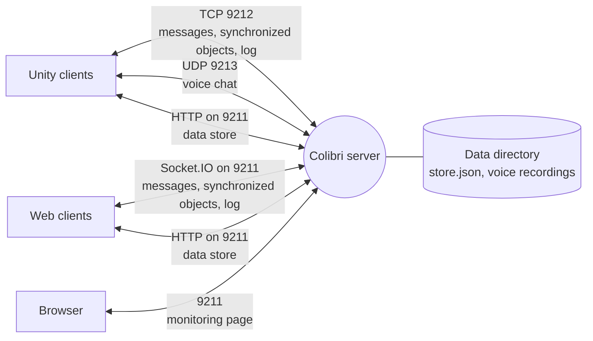
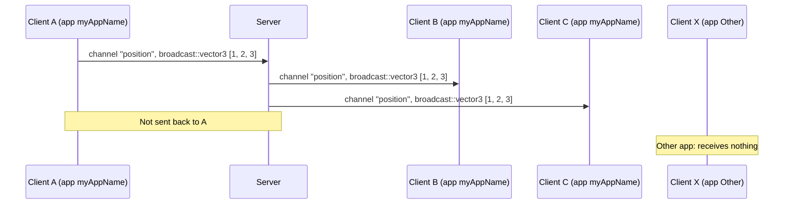
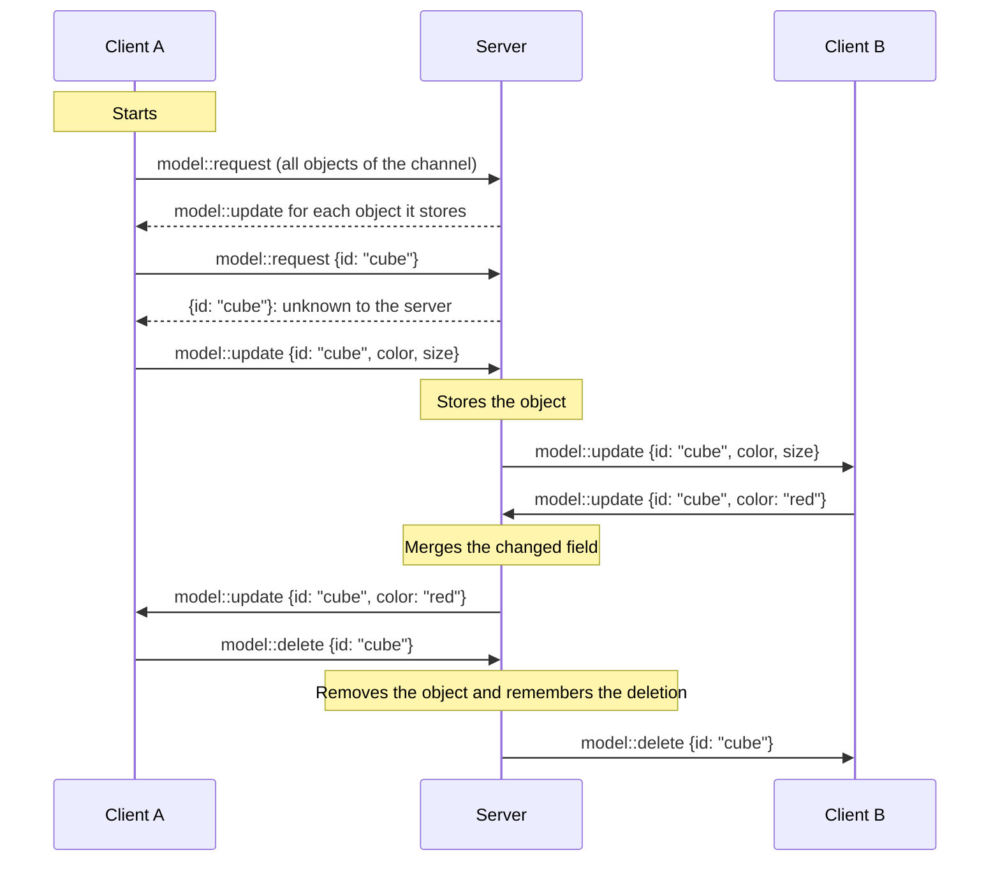
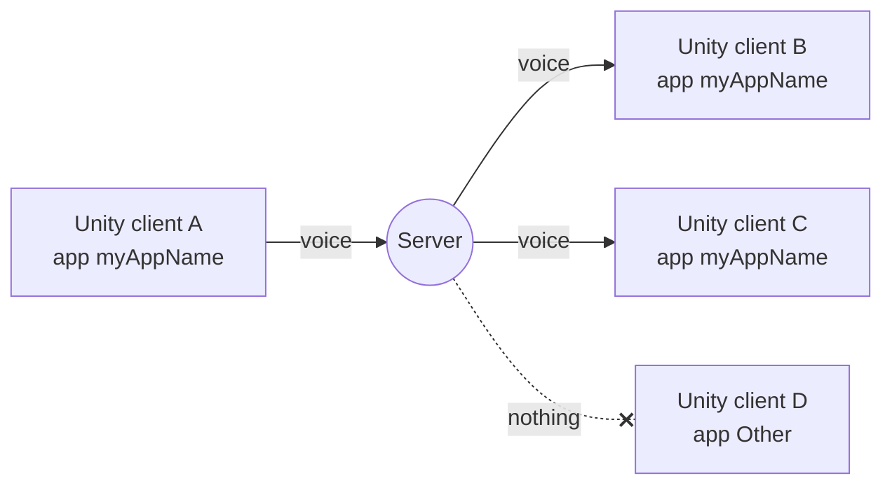

# Protocol

This page explains how Colibri works under the hood: how clients connect, what they send, and what the server does
with it. You do not need it to use Colibri. It helps to understand what you see on the
[monitoring page](./monitoring.md), and to find the cause of a problem.

## Parts and connections



| Connection                 | Port     | Used for                                                                    |
| -------------------------- | -------- | --------------------------------------------------------------------------- |
| Unity client over TCP      | 9212/tcp | Messages, synchronized objects and the client's log, in a binary format     |
| Web client over Socket.IO  | 9211/tcp | The same, as Socket.IO events                                               |
| Voice chat over UDP        | 9213/udp | Audio of Unity clients                                                      |
| Data store over HTTP       | 9211/tcp | Values that are saved on the server and survive restarts                    |
| Monitoring page            | 9211/tcp | The [monitoring page](./monitoring.md) in the browser                       |

Unity and web clients use different connections, but the server treats their messages the same way. A message from
a Unity client reaches the web clients of its app, and the other way round. With [TLS](./configuration.md#tls), the
TCP and web connections are encrypted. Their content stays the same.

## Apps

Every client connects with an **app name**. The server keeps apps apart: a client only sees the messages,
synchronized objects and voice chat of clients with the same app name. Clients of other apps on the same server are
invisible to it.

Unity and web clients with the same app name belong to the same app. Give each project its own app name, especially
on a shared server.

:::note
The app name `colibri` is reserved for the monitoring page. Do not use it, nor the channel names `colibri`, `log`, or
names starting with `colibri::`.
:::

## What clients send

Each message has three parts: a **channel** (a name the clients choose, e.g. `position`), a **command** (what kind of
message it is) and a **payload** (the content, usually JSON).

| Kind                 | Command                                  | What the server does                                                                                 |
| -------------------- | ---------------------------------------- | ---------------------------------------------------------------------------------------------------- |
| Message              | `broadcast::<type>`, e.g. `broadcast::vector3` | Passes it to every other client of the app. Stores nothing.                                     |
| Synchronized objects | `model::request`                         | Answers the asking client with the objects it stores                                                 |
|                      | `model::update`                          | Merges the changed fields into its copy of the object, and passes the update to every other client  |
|                      | `model::delete`                          | Removes its copy, remembers the deletion for a while, and passes it to every other client           |
| Log                  | `debug`, `info`, `warn`, `error` on the channel `log` | Writes the line into the server's log, at that level                                       |

The server also tells the clients of an app when a client joins or leaves (`client::connected`,
`client::disconnected`).

Other commands reach no other client. The server logs a warning about them. Colibri's client libraries choose the
right commands for you ([Unity messages](../unity/messages.md), [web messages](../web/messages.md)).

## Messages

A message goes from the sender through the server to every other client of the same app. It does not come back to
the sender. The server does not store it, so a client that connects later does not receive it.



Messages suit things that change all the time, such as a position. For a state that new clients must see, use
synchronized objects or the data store.

## Synchronized objects

The server keeps a copy of every synchronized object, per app and channel. That way, a client that joins later gets
the current state.



- **On start**, a client requests the objects it needs. The server answers with what it has. If it has nothing for
  an object, the client sends the object's full state, and the server stores it.
- **An update** usually carries only the fields that changed. The server merges them into its copy, field by field,
  and passes the update on.
- **A delete** removes the object. For 10 minutes (`MODEL_TOMBSTONE_SECONDS`), the server remembers the deletion and
  ignores late updates for the object, so that they cannot bring it back ([Deleted
  objects](./configuration.md#deleted-objects)).
- **Only in memory:** the server forgets an app's objects when its last client leaves, and when it restarts. To keep
  data, use the [data store](#data-store).

The _Models_ page of the [monitoring page](./monitoring.md#models) shows the objects the server stores.

## Reconnects

Clients reconnect on their own when the connection breaks. Unity clients try again after 0.5 seconds, then less
often, up to every 10 seconds. After a reconnect, each client asks again for the objects it holds, and handles the
answer:

| Answer from the server  | Meaning                                                    | The client                         |
| ----------------------- | ---------------------------------------------------------- | ---------------------------------- |
| The object              | Others may have changed it meanwhile                       | Takes the changes                  |
| Unknown                 | The server forgot it, e.g. after a restart                 | Sends its full state again         |
| Deleted                 | Another client deleted it meanwhile                        | Removes its copy                   |

Both clients also notice changes that were lost when the connection broke, and send them again.

The server and the clients keep checking that a connection is alive:

| Client | Check                                                                                                                                     |
| ------ | ----------------------------------------------------------------------------------------------------------------------------------------- |
| Unity  | The server sends a heartbeat ten times a second, and the client answers. It shows the latency. Silent for 10 seconds, the client is disconnected ([Idle timeout](./configuration.md#idle-timeout)). Without a heartbeat for 2 seconds, the client reconnects. |
| Web    | The server sends a latency check ten times a second. Socket.IO notices a lost connection within about 45 seconds.                         |

## Data store

The data store keeps values on the server, in `store.json` in the data directory. Unlike synchronized objects, the
values survive restarts. Clients read and write them over HTTP on the web port. Each value belongs to an app and has
a key.

| Request                          | Result                                                                                 |
| -------------------------------- | -------------------------------------------------------------------------------------- |
| `GET /api/store`                 | The names of all apps                                                                  |
| `GET /api/store/<app>`           | The keys of the app                                                                    |
| `GET /api/store/<app>/<key>`     | The value. `404` if there is none.                                                     |
| `PUT /api/store/<app>/<key>`     | Stores the JSON value in the request body. `201` if it is new, `200` if it replaced a value. |
| `DELETE /api/store/<app>/<key>`  | Deletes the value                                                                      |
| `DELETE /api/store/<app>`        | Deletes every value of the app                                                         |

Values are JSON with the media type `application/vnd.colibri.v2+json`. A `PUT` must send this `Content-Type`, or it
gets `415` and stores nothing. With curl:

```sh
curl -X PUT -H 'Content-Type: application/vnd.colibri.v2+json' -d '{"x":1}' http://localhost:9211/api/store/myAppName/myKey
curl http://localhost:9211/api/store/myAppName/myKey
```

- A value may be up to 5 MiB.
- Write app names and keys with special characters such as `/`, `?` or spaces percent-encoded.
- Any web page may use the data store, also one served from elsewhere.
- The server saves changes to `store.json` within a quarter of a second.

The client libraries do all of this for you ([Unity data store](../unity/data-store.md),
[web data store](../web/data-store.md)).

## Voice chat

Unity clients send their voice as small UDP packets to port 9213. Each packet carries an id of its app. The server
passes each packet to every other client of the same app that sends voice.



- The server relays voice only from an address where a Unity client of the same app is connected over TCP.
- The server learns a client's address from its voice. A client hears others only while it sends voice itself.
- Voice is not encrypted, also with TLS on.

[Voice chat](./configuration.md#voice-chat) on the Configuration page lists what the server needs.

## Protocol version

Colibri 2 changed how clients and the server talk to each other. When a client connects, it sends its protocol
version. The server accepts only its own version. Colibri 2 uses protocol version 2.

| Client                | Server     | Result                                                                                                     |
| --------------------- | ---------- | ---------------------------------------------------------------------------------------------------------- |
| Colibri 2             | Colibri 2  | Works                                                                                                      |
| Colibri 1 Unity       | Colibri 2  | Refused. The server log says `it looks like a Colibri 1.x client`. The client keeps trying.                |
| Colibri 1 web         | Colibri 2  | Refused. The server log says `Unsupported protocol version '1'`. The client shows no error.                |
| Colibri 2 Unity       | Colibri 1  | Does not connect. The Unity client logs that the server may be too old.                                    |
| Colibri 2 web         | Colibri 1  | Works, but the web client warns after 5 seconds that the server may be too old.                            |

A refused client never appears on the monitoring page. Only the server's log names it.

The protocol version is not the release version. Every Colibri 2 client works with every Colibri 2 server, e.g. a
2.1 client with a 2.0 server.

## Limits

| What                                 | Limit                                                                            |
| ------------------------------------ | -------------------------------------------------------------------------------- |
| One message or object update         | About 5 MiB. A larger one closes the client's connection.                         |
| One data store value                 | 5 MiB                                                                            |
| Messages and updates per client      | 1000 per second by default ([Load limits](./configuration.md#load-limits))       |

## Full specification

This page leaves out the details. If you write your own client, for example in another language, read the
[full protocol specification](https://github.com/hcigroupkonstanz/Colibri/blob/develop/colibri-server/docs/dev/protocol.md).
